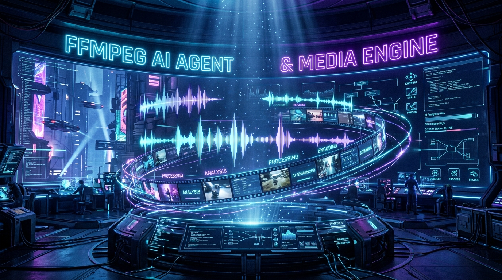
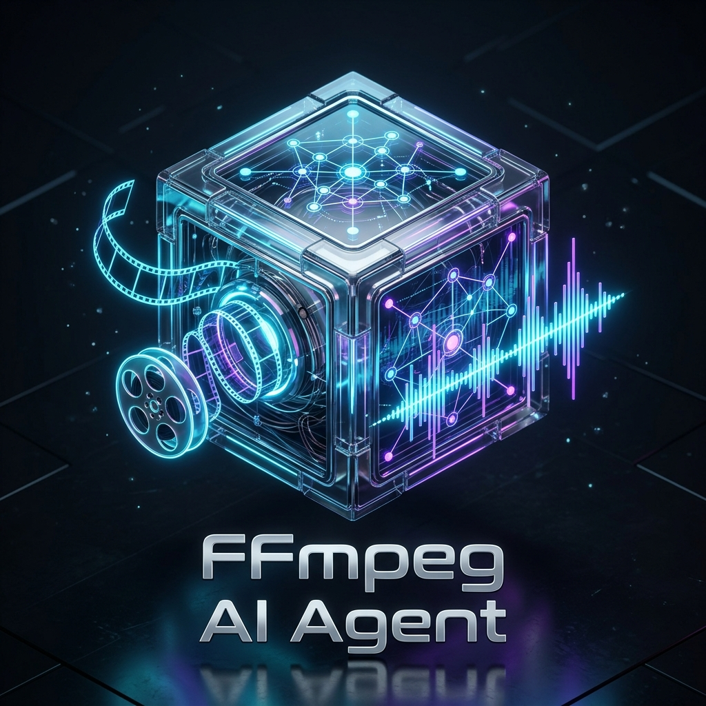

<div align="center">

  

  <br/><br/>

  

  # 🎬 Omniverse Enterprise FFmpeg Media Agent
  ### 🔮 270+ Engine Suite & 364 Hollywood Cinema Effects for Windows & AI Agents

  <p align="center">
    <b>Chạy trên Windows với TypeScript/Node.js • Tự động Bootstrap • Chuẩn hóa cho OpenAI Codex & Google Antigravity</b>
  </p>

  <p align="center">
    <a href="https://nodejs.org/"></a>
    <a href="https://www.typescriptlang.org/"></a>
    <a href="https://ffmpeg.org/"></a>
    <a href="https://vitest.dev/"></a>
    <a href="https://github.com/"></a>
    <a href="LICENSE"></a>
  </p>

  

  <br/>

  

  <p align="center">
    <a href="#-1-khởi-động-tự-động-1-chạm-auto-bootstrap"><b>⚡ Auto-Bootstrap</b></a> •
    <a href="#-cấu-trúc-dự-án"><b>📁 Cấu Trúc</b></a> •
    <a href="#-2-270-tính-năng-chuẩn-doanh-nghiệp-quốc-tế"><b>🚀 270+ Tính Năng</b></a> •
    <a href="#-3-kho-364-hiệu-ứng-điện-ảnh-hollywood"><b>🎨 364 Cinema FX</b></a> •
    <a href="#-4-rào-chắn-an-toàn-guard-rails"><b>🛡️ Guard Rails</b></a> •
    <a href="#-5-kích-hoạt-trong-codex--antigravity"><b>🤖 AI Agents</b></a>
  </p>

</div>

---

## ⚡ 1. Khởi Động Tự Động 1 Chạm (Auto-Bootstrap)

Tự động nạp `PATH`, cài đặt Node.js LTS, FFmpeg 9.0.1 và biên dịch dự án:

<table>
<tr>
<th width="50%">🔹 Command Prompt (CMD)</th>
<th width="50%">🔹 PowerShell</th>
</tr>
<tr>
<td>

```cmd
cmd.exe /c bootstrap.cmd
```

</td>
<td>

```powershell
.\bootstrap.ps1
```

</td>
</tr>
</table>

---

## 📁 Cấu Trúc Dự Án

```text
SKILL_FFMPEG_AGENT/
├── README.md                                  # Hướng dẫn chi tiết
├── bootstrap.cmd                              # Tự động nạp PATH, cài Node/FFmpeg, build với 1 click
├── bootstrap.ps1                              # Auto-bootstrap PowerShell
├── package.json                               # Dependencies & scripts
├── tsconfig.json                              # TypeScript ES2022 / NodeNext
├── batch.example.json                         # Mẫu batch manifest
├── batch_effects.json                         # Mẫu batch hiệu ứng
├── assets/                                    # 3D Banner, Logo, Studio Preview & Animated SVGs
├── .agents/skills/ffmpeg-media-agent/SKILL.md # Định nghĩa Skill 120+ tính năng cho Codex & Antigravity
├── src/
│   ├── types.ts                               # Zod schemas & types
│   ├── validator.ts                           # Rào chắn an toàn, chống ghi đè
│   ├── inspector.ts                           # Thăm dò ffprobe metadata
│   ├── executor.ts                            # FFmpeg spawn engine & retry fallback
│   ├── batch.ts                               # Bộ thực thi xử lý hàng loạt
│   ├── doctor.ts                              # Kiểm tra môi trường Node.js & FFmpeg
│   ├── cli.ts                                 # CLI hợp nhất toàn bộ 120+ tính năng
│   ├── index.ts                               # Module exports
│   ├── infinite/studio.ts                     # B-Roll, Auto-Ducking, Progress Bar, Splicer...
│   ├── titan/suite.ts                         # Timecode burn, Deshake, SSIM/PSNR, De-esser...
│   ├── cinema/studio.ts                       # HLS, HDR Tone-mapping, Scene detect, Vocals split...
│   ├── advanced/engine.ts                     # Nén dung lượng, EBU R128, Smart Crop, Watermark...
│   ├── effects/                               # 104 hiệu ứng điện ảnh Hollywood
│   └── tracking/                              # AI Vision Face Tracking & AR Bridge
├── tests/validation.test.ts                   # Unit tests Vitest
├── samples/                                   # File media mẫu đầu vào & AR sticker assets
└── work/                                      # Thư mục đích chứa output (đã .gitignore)
```

---

## 🚀 2. 270+ Tính Năng Chuẩn Doanh Nghiệp Quốc Tế

| Nhóm Tính Năng | Lệnh Thực Thi Tiêu Biểu | Mục Đích |
| :--- | :--- | :--- |
| 🎬 **B-Roll Insert** | `node dist/cli.js insert-broll "main.mp4" "broll.mp4" "work/out.mp4" --start 2 --duration 3` | Chèn video phụ đè lên video chính |
| 🎙️ **Auto-Ducking** | `node dist/cli.js auto-ducking "voice.mp4" "bgm.mp3" "work/ducked.mp4"` | Tự động hạ nhỏ nhạc nền khi có tiếng nói |
| ⏱️ **Progress Bar** | `node dist/cli.js add-progress-bar "input.mp4" "work/progress.mp4" --height 10` | Thanh tiến trình video TikTok / Reels |
| 🛡️ **Blur Privacy** | `node dist/cli.js blur-privacy "input.mp4" "work/blurred.mp4"` | Làm mờ bảo mật khuôn mặt bầu dục |
| 🔔 **Follower CTA** | `node dist/cli.js follower-cta "input.mp4" "work/cta.mp4" --text "FOLLOW ME"` | Nút kêu gọi hành động chuyển động động |
| 🎧 **3D Stereo** | `node dist/cli.js widen-stereo "input.mp4" "work/wide.mp4"` | Mở rộng không gian âm thanh vòm 3D |
| ⏱️ **SMPTE Timecode**| `node dist/cli.js burn-timecode "input.mp4" "work/tc.mp4" --timecode "01:00:00:00"` | In mã thời gian phát sóng chuyên dụng |
| 🎥 **Deshake** | `node dist/cli.js stabilize "input.mp4" "work/stabilized.mp4"` | Chống rung video 2-pass mượt mà |
| 📊 **VMAF / SSIM** | `node dist/cli.js benchmark-quality "original.mp4" "converted.mp4"` | Đo lường chất lượng chuẩn Netflix |
| 🏷️ **Lower-Third** | `node dist/cli.js animated-lower-third "input.mp4" "Hoang Apex" "Architect" "work/lt.mp4"` | Thanh giới thiệu tên hoạt họa chuyên nghiệp |
| 📡 **HLS Stream** | `node dist/cli.js package-hls "input.mp4" "work/hls" --segment-duration 3` | Đóng gói phát trực tuyến đa bitrate |
| 🎤 **Isolate Vocals**| `node dist/cli.js isolate-vocals "input.mp4" "work/vocals.mp3" "work/bgm.mp3"` | Tách riêng lời thoại và nhạc nền |
| 🗜️ **Target-Size** | `node dist/cli.js compress-target-size "input.mp4" "work/15mb.mp4" --size-mb 15` | Nén chính xác theo số MB mong muốn |
| 🔊 **EBU R128** | `node dist/cli.js normalize-audio "input.mp4" "work/norm.mp4" --target -16` | Chuẩn hóa âm lượng chuẩn truyền hình |
| 📝 **Hard Subtitles**| `node dist/cli.js burn-subtitles "input.mp4" "sub.srt" "work/burned.mp4"` | Đốt phụ đề cứng vào từng khung hình |
| 📱 **Smart 9:16** | `node dist/cli.js smart-crop-916 "input.mp4" "work/tiktok.mp4"` | Cắt thông minh sang định dạng dọc |
| 🎯 **AI Tracking** | `node dist/cli.js track-face "input.mp4" "work/face.json"` | Nhận diện & bám dính Sticker AR theo đầu |

---

## 🎨 3. Kho 364 Hiệu Ứng Điện Ảnh Hollywood

<div align="center">
  
</div>

<br/>

Tra cứu toàn bộ danh mục hiệu ứng:
```powershell
node dist/cli.js effects
```

Áp dụng hiệu ứng điện ảnh:
```powershell
# Blade Runner 2049 Amber Haze
node dist/cli.js apply-effect bladerunner_2049_amber "samples\demo_video.mp4" "work\bladerunner.mp4"

# Wes Anderson Grand Budapest Pastel Yellow
node dist/cli.js apply-effect wes_anderson_symmetry "samples\demo_video.mp4" "work\wes_anderson.mp4"

# Oppenheimer IMAX 70mm B&W Dramatic
node dist/cli.js apply-effect oppenheimer_70mm_monochrome "samples\demo_video.mp4" "work\oppenheimer.mp4"

# Matrix Cyber Green Dystopia
node dist/cli.js apply-effect matrix_code_rain_green "samples\demo_video.mp4" "work\matrix.mp4"

# Tilt-Shift Miniature Model World (Thành phố đồ chơi)
node dist/cli.js apply-effect tilt_shift_miniature "samples\demo_video.mp4" "work\miniature.mp4"

# Kodak 500T Halation đỏ rực quầng sáng điện ảnh
node dist/cli.js apply-effect film_halation_red "samples\demo_video.mp4" "work\halation.mp4"

# Âm thanh 8D Spatial Binaural xoay vòng 360 độ quanh đầu
node dist/cli.js apply-effect audio_8d_spatial_orbit "samples\demo_video.mp4" "work\8d_audio.mp4"
```

---

## 🛡️ 4. Rào Chắn An Toàn (Guard Rails)

<table>
<tr>
<td width="33%" align="center">
  <h3>🚫 Zero Overwrite</h3>
  <p>Chống ghi đè file gốc tuyệt đối.<br/><b><code>input !== output</code></b></p>
</td>
<td width="33%" align="center">
  <h3>🔒 Anti-Injection</h3>
  <p>Truyền tham số dạng mảng rời rạc qua <code>execFile</code>.</p>
</td>
<td width="33%" align="center">
  <h3>🔄 Smart Fallback</h3>
  <p>Tự động chuyển <b><code>pix_fmt yuv420p</code></b> khi lỗi Profile.</p>
</td>
</tr>
</table>

---

## 🤖 5. Kích Hoạt Trong Codex & Antigravity

- **File Skill:** `[.agents/skills/ffmpeg-media-agent/SKILL.md](file:///.agents/skills/ffmpeg-media-agent/SKILL.md)`
- **Prompt mẫu:**
  > *"Sử dụng skill ffmpeg-media-agent để kiểm tra video trong thư mục samples, tự động chèn B-Roll ở giây thứ 2, chuẩn hóa âm thanh EBU R128 và áp dụng màu điện ảnh Blade Runner 2049 vào thư mục work."*

---

<div align="center">
  <sub>⚡ Infinite Apex &bull; 🛡️ Safe &bull; 🤖 AI-Agent Ready &bull; 120+ Engine Suite &bull; 104 Cinema Effects</sub>
</div>
